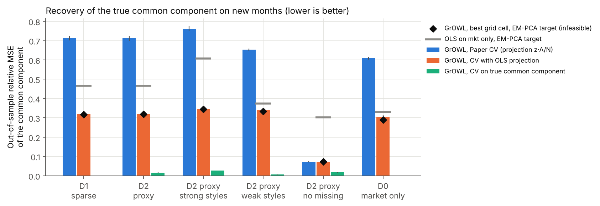
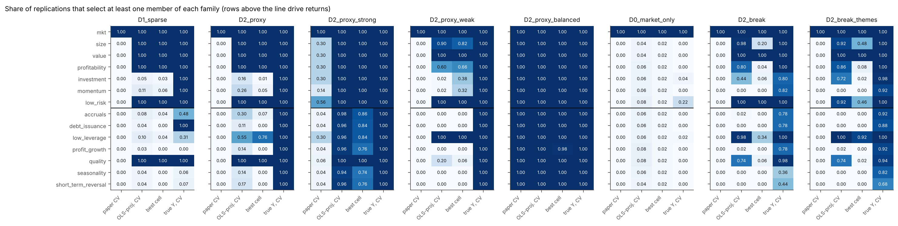
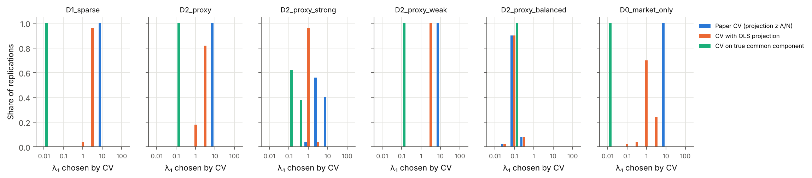
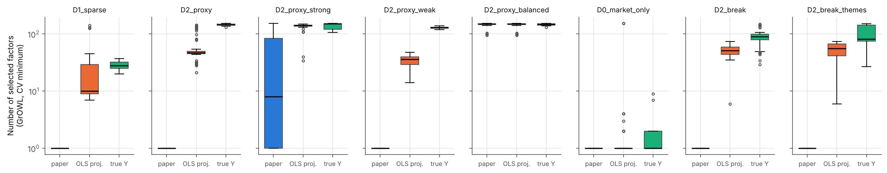

# Monte Carlo validation of GrOWL for factor-zoo compression

This example tests the GrOWL procedure of a latent + observed factor study of
the factor zoo. The study does these steps:

1. It estimates latent factors from an unbalanced panel of stock returns
   (Stock-Watson EM-PCA, Bai-Ng criterion PC_p2, `kmax = 10`).
2. It standardizes the common component of returns, Y = F̂Γ̂', and the
   observed factor zoo X (154 factors).
3. It regresses Y on X with GrOWL (one row of B per observed factor, one
   column per firm).
4. It selects (λ₁, λ₂, ρ) by inside-loop PCA hv-block cross-validation: the
   EM-PCA is fit again on each training block, and the validation months are
   projected onto the training loadings.

The empirical result of the study is that the selected cell keeps only the
market factor. The simulation asks: when the true process has seven factors,
does this procedure find them?

<!-- RESULTS-START -->
## Main results (400 replications)

Scenarios: D1 and D2 with 100 replications each; D2 with strong styles, D2
with weak styles, D2 with no missing returns and D0 with 50 replications
each. All tables are in [`results/summary_tables.md`](results/summary_tables.md).

**1. The GrOWL solver and the GrOWL estimator work as expected.**

- The compiled solver repeats the iterates of `growl_fista`. In 800 cells that
  were solved again with `growl_fista` itself, the support was the same in
  100% of the cells and the iteration count was the same in 99%. With
  ρ = 0, `growl_fista` gives the `sklearn` multi-task LASSO solution
  (difference about 1e-9).
- When the target is the true common component, cross-validated GrOWL finds
  every family that drives returns in 100% of the replications of every
  scenario. Its out-of-sample error is 0.000–0.027.
- At the cells that the pipeline selects, the `tol = 1e-4` solution has the
  same support as a `tol = 1e-9` solution (Jaccard index ≥ 0.999). The
  supports differ only at λ₁ = 0.01, which the CV selects with the true
  target in D1 and D0: there FISTA stops at `max_iter` in 42% of the D1
  replications, and the Jaccard index is 0.94 (D1) and 0.85 (D0).

**2. The inside-loop CV of the study selects the market for a mechanical
reason.**

| Scenario | Paper CV: market-only choice | Paper CV: median λ₁ | Validation-target variance (paper / OLS projection) | Spearman(CV loss, true loss) (paper / OLS projection) |
|---|---|---|---|---|
| D1 sparse | 100% | 10 | 0.027 / 0.739 | −0.73 / +0.98 |
| D2 proxy | 100% | 10 | 0.027 / 0.739 | −0.73 / +0.98 |
| D2 strong styles | 44% | 3.16 | 0.027 / 0.725 | −0.75 / +0.99 |
| D2 weak styles | 100% | 10 | 0.026 / 0.744 | −0.61 / +0.95 |
| D2 no missing | 0% | 0.1 | 0.960 / 0.960 | +1.00 / +1.00 |
| D0 market only | 100% | 10 | 0.026 / 0.734 | −0.59 / +0.95 |

- The study projects the validation months onto the training loadings as
  f_t = z_t Λ / N, with z = 0 for unobserved firms. About 75% of the firms
  are unobserved in a validation month, so the validation target keeps only
  about 3% of its variance (the training target has variance 1).
- A near-zero validation target rewards the cells that predict almost
  nothing. So the CV loss ranks the cells in the opposite order of the true
  out-of-sample loss, and the CV selects λ₁ = 10 with only the market, as in
  the empirical application. The true process has seven factors.
- The selected cell shrinks the market coefficient so much that its
  out-of-sample error (0.71 in D1 and D2) is larger than the error of OLS on
  the market alone (0.47). The multi-task LASSO path under the same CV
  selects an empty model in 50% of the D1 and D2 replications.
- With no missing returns the same procedure works (it makes the same choice
  as the corrected CV). The cause is the projection of an unbalanced panel,
  not GrOWL and not the hv-block design.

**3. With an OLS projection the CV works.** The OLS projection regresses the
observed z_t on their loadings (the EM E-step with Λ fixed).

- The CV choice is within 0.002–0.005 of the best cell on the grid in D1 and
  D2 (0.016 in D0); see the orange bars in the figure.
- It selects the market, size, value, profitability and low risk in 100% of
  the D1 and D2 replications. Investment and momentum are selected in only
  5–26%: the first stage does not recover them well (see point 4).
- Under a market-only truth it selects only the market in 80% of the
  replications, and in 100% with the one-standard-error rule.

**4. The first stage limits what any second stage can find.** With a
CRSP-like panel (71% missing), the EM-PCA common component has a mean
squared correlation of 0.66 with the true common component (0.94 with no
missing returns). The best GrOWL cell on the grid then has an out-of-sample
error of 0.32, against 0.00–0.02 with the true target.

**5. GrOWL against the multi-task LASSO and Elastic Net.** All three use the
corrected CV.

| Scenario | Method | OOS rel. MSE | # selected | members per selected style family | factor TPR | factor FDR |
|---|---|---|---|---|---|---|
| D1 sparse | GrOWL | 0.319 | 21.5 | 3.3 | 0.73 | 0.59 |
| D1 sparse | MT-LASSO | 0.319 | 9.9 | 1.3 | 0.72 | 0.48 |
| D1 sparse | MT-ENet | 0.354 | 90.0 | 9.9 | 0.85 | 0.93 |
| D2 proxy | GrOWL | 0.322 | 57.5 | 9.7 | 0.53 | 0.18 |
| D2 proxy | MT-LASSO | 0.322 | 28.5 | 5.8 | 0.29 | 0.14 |
| D2 proxy | MT-ENet | 0.357 | 91.2 | 10.0 | 0.70 | 0.34 |

- GrOWL and the multi-task LASSO predict equally well (difference ≤ 0.007 in
  all scenarios). The Elastic Net is worse by 0.01–0.04 in the scenarios with
  style factors and missing returns.
- GrOWL keeps more members of each selected family, with rows that point in
  the same direction (mean within-family cosine 0.98–0.99). When the zoo holds
  noisy proxies of a latent factor (D2), this gives a better coverage of the
  proxies at a similar FDR. When the zoo holds the true factor and redundant
  copies (D1), the extra members are false positives at the factor level.
- Under the one-standard-error rule GrOWL often selects a ρ = 0 cell, so its
  results equal the multi-task LASSO results.

**6. Family-level truth is not fully identifiable in a realistic zoo.** The
"irrelevant" quality theme is selected in 100% of the D1 and D2
replications, and low leverage in 10–55%. Their theme returns are highly
correlated with the true factors (low leverage: −0.93 with value, −0.84 with
low risk; quality: 0.53 with profitability), so they are near substitutes.

**7. Exact row-norm ties are weak evidence of family membership.** In the
GrOWL tie groups, 15–31% of the pairs belong to the same family, against a
chance level of 9–27% among all selected pairs.

**8. Calibration check.** The first stage of D1 and D2 gives a common
component that is more market-dominated than in the data (R² of Y on the
market 0.51, data 0.36). `D2_proxy_strong` (style betas × 1.5) matches the
PCA moments (R² on the market 0.39, first singular-value share 0.43 against
0.41), with a higher firm R² (0.39 against 0.32). In that scenario the paper's
CV still fails (out-of-sample error 0.76 against 0.35 with the corrected
CV), but it selects multi-factor cells in 56% of the replications.

### What this means for the empirical application

- The market-only selection is what this CV design produces under a
  seven-factor truth. So it is not evidence that the zoo adds nothing beyond
  the market.
- A read-only check on the empirical folds found the same attenuation: the
  mean validation-target variance is 0.018–0.065 with the original projection
  and 0.38–1.16 with the OLS projection.
- Use an OLS (E-step) projection for the out-of-fold months, and report the
  support of the near-optimal cells as a set, because the top of the CV
  landscape is flat (10–28 cells within one standard error in the
  simulation).
- GrOWL's advantage over the multi-task LASSO is family coverage, not
  prediction. Equal row norms alone do not identify factor families.

<!-- RESULTS-END -->

## Data-generating processes

Returns follow a linear approximate factor model of the APT type (Ross, 1976;
Chamberlain and Rothschild, 1983), with zero pricing errors:

    r_it = β_i' f_t + e_it,   f_t ~ N(μ_f, Σ_f),   e_it ~ N(0, s_i²).

The seven factors in f_t are the market and six style factors: size, value,
profitability, investment, momentum and low risk. The factor zoo has 154
columns: the market and 153 members of the 13 Jensen-Kelly-Pedersen themes.
Each member k of theme c is x_k = μ_c + σ_c (λ_k z_c + (1 − λ_k²)^½ u_k),
with z_c the standardized theme factor and u_k independent noise.

| Process | Link between f_t and the zoo | Truth |
|---|---|---|
| D1 `sparse` (Feng, Giglio and Xiu, 2020) | The market and the first member of each style theme **are** the seven factors (λ = 1). The other members are redundant copies; seven more themes are correlated with f_t but have no effect on returns. | 7 nonzero rows of B |
| D2 `proxy` (Giglio and Xiu, 2021) | Only the market is observed exactly. The style factors are latent, and the zoo holds noisy proxies of them (λ_k < 1). | 7 relevant families (85 columns); the population B outside them is near zero (99.9% of the population row-norm mass is in the relevant families) |
| D0 `market_only` | Only the market drives returns. | 1 nonzero row (mkt) |

Scenarios: `D1_sparse`, `D2_proxy`, `D0_market_only`, `D2_proxy_balanced` (no
missing returns), `D2_proxy_weak` (style betas × 0.5) and `D2_proxy_strong`
(style betas × 1.5). The scenarios use common random numbers: replication r of
every scenario uses the same seed.

**Regime change.** Two more scenarios add a structural break at month
T/2 to D2:

| Scenario | What changes at the break |
|---|---|
| `D2_break` | The style betas of every firm are drawn again from the same distribution, and the proxy loadings λ_k are permuted inside each theme (another member becomes the best proxy of its theme). |
| `D2_break_themes` | As `D2_break`, and three style themes (investment, momentum, low risk) stop driving returns while three other themes (accruals, debt issuance, low leverage) start. |

The return factors are stacked by regime, f_t = [mkt_t, s_t·1{t < T/2},
s'_t·1{t ≥ T/2}], so the common component is still c_t = B f_t with one
loading matrix. The test months have the break at the same point. The
population mapping uses the averages of the two regime moments. In
`D2_break_themes` 10 families (110 columns) are relevant. The first-regime
parameters of replication r (betas, loadings, idiosyncratic volatilities,
listing spells) are those of replication r of `D2_proxy`; the factor and
return draws are different.

### Calibration

All parameters come from summary moments of the empirical data (CRSP monthly
returns 1973–2023 and JKP Global Factor Data, US, value-weighted capped). The
moments are in `calibration.py`. No data file is part of this package.

| Input | Source moment |
|---|---|
| T = 610 months, N = 1,965 firms, K = 154 | sample of the study |
| Means, volatilities and correlations of the market and the 13 theme returns | JKP theme returns |
| λ_k of each member | correlation of each JKP factor with its own theme return |
| Firm betas β_i ~ N(m, S) | firm-by-firm OLS on mkt and six theme returns (firms with ≥ 120 months); S is deflated by the mean sampling covariance |
| Idiosyncratic volatility, lognormal | OLS residuals, mean shifted so that the mean firm R² is 0.318 (data: 0.318; market only 0.230) |
| Listing spells | one contiguous spell per firm; start and length quantiles of the CRSP panel |

The synthetic zoo is close to the real zoo:

| Moment | Data | Simulation |
|---|---|---|
| Eigenvalue shares 1–4 of corr(X) | 0.357, 0.144, 0.077, 0.051 | 0.333, 0.128, 0.060, 0.034 |
| Correlation quantiles 5/25/50/75/95% | −0.57, −0.16, 0.05, 0.34, 0.77 | −0.51, −0.15, 0.04, 0.23, 0.72 |
| Share of \|corr\| > 0.8 | 4.8% | 3.3% |
| Member-to-own-theme correlation, median | 0.83 | 0.84 |

## Pipeline in each replication

The code repeats the study pipeline. These parts are equal to the study code:

- EM-PCA (`first_stage.py`) is a NumPy port of the study's `factors_em`: same
  outlier filter (10 × IQR), same standardization, Bai-Ng PC_p2 at every EM
  step, stop at relative change < 1e-6 or 500 steps, and the same out-of-fold
  projection. On a test panel the port gives the same common component,
  the same k and the same projection as the study code (difference ≈ 1e-14).
- hv-block splits: 5 folds, h = ⌊0.25 T⌋ = 152, v = ⌊√T⌋ = 24, so each training
  set has 257 months.
- GrOWL: `growl_fista` with `check_type='solution_diff'`, `tol = 1e-4`,
  `max_iter = 5000`; X and Y are standardized with training statistics.

Differences from the study:

- The grid has 117 cells (λ₁ ∈ 10^{−2,…,2} in 9 steps; λ₂ ∈ {0.001, 0.01, 0.1, 1};
  ρ ∈ {0.25, 0.75, 1}; plus ρ = 0 for each λ₁) instead of 594.
- Two exact computational devices (see `second_stage.py`):
  1. The target Y has rank k. With Y = Y_r V' (V orthonormal), the GrOWL
     solution is B̂ = Ĉ V', where Ĉ solves the same problem with the k columns
     of Y_r. Row norms and supports are the same. A test checks this.
  2. The FISTA iterations of `growl_fista` are run on X'X/n and X'Y/n in a
     compiled kernel (`numba`, NumPy fallback). The tests check that the
     iterates equal those of `growl_fista`, and each replication re-solves two
     random cells with `growl_fista` itself.

### Cross-validation variants

Each replication scores every cell under three CV variants on the same folds:

| Variant | Validation target |
|---|---|
| `pipeline` (paper) | EM-PCA common component of the validation months, projected as in the study: f_t = z_t Λ / N, with z = 0 for unobserved firms |
| `pipeline_olsproj` | same, but f_t is the OLS regression of the observed z_t on their loadings (the EM E-step with Λ fixed) |
| `oracle` | the true common component (no first-stage error) |

The first two variants select among the same full-sample refits (target: the
full-sample EM-PCA common component). The third uses the true common
component also in the refit.

### Selection rules and benchmarks

- `cv_min`: lowest mean CV MSE. `cv_min_clean`: lowest mean CV MSE among
  cells that converged in all folds (the study's promotion rule). `cv_1se`:
  the sparsest cell within one standard error of the minimum. `oracle`: the
  cell with the lowest out-of-sample error (not feasible in practice; it shows
  the best result that the grid allows).
- Benchmarks on the same folds: multi-task LASSO (the ρ = 0 cells) and the
  multi-task Elastic Net (`sklearn`, α ∈ 10^{−2,…,2.5} in 10 steps,
  l1_ratio ∈ {0.1, 0.5, 0.9}). Also OLS on all 154 factors, on the market
  only, and on the true support.

### Metrics

- **OOS relative MSE**: mean over firms of Var(ĉ_i − c_i) / Var(c_i) on 610
  new months, where c_i is the true common component and ĉ_i is the common
  component implied by the fitted mapping. **OOS 1 − corr²** is the
  scale-free version.
- **Factor TPR / FDR**: share of the true columns that are selected; share of
  the selected columns that are not true columns (D2: the true columns are
  all 85 members of the relevant families).
- **Family TPR / FPR**: share of the 7 relevant families with at least one
  selected member; share of the 7 irrelevant families with at least one.
- Grouping: mean cosine between the selected rows of one style theme, and
  the number of factors in exact row-norm ties.
- Solver accuracy: each selected cell is solved again with `tol = 1e-9`; the
  table reports the Jaccard index between the two supports.
- **Split-half stability**: GrOWL at the CV-selected cell is fitted on each
  half of the sample (each half centered on its own means) and scored on
  both halves. The table reports the mean within-half R², the mean
  across-half R² (fit on one half, score on the other), the same two numbers
  for OLS on the market only, the Jaccard index of the two supports and the
  mean cosine between the rows that both halves select. For the stored
  replications of earlier scenarios, `run_simulation.py --add-split-half`
  computes these numbers from the same draws and selected cells.

## How to run

    pip install growl_reg numba joblib scipy pandas matplotlib
    python run_simulation.py --list
    python run_simulation.py --scenario D2_proxy --reps 100 --n-jobs 4
    python summarize.py

One replication takes about 150 s on one core (the EM-PCA takes most of it).
The 400 replications of the results above took about 4 hours on 4 cores.
Each replication is saved in `results/raw/<scenario>/`, so a stopped run
continues where it stopped. `summarize.py` writes the tables and figures in
`results/`.

## Files

| File | Content |
|---|---|
| `calibration.py` | empirical moments and their provenance |
| `dgp.py` | data-generating processes and population quantities |
| `first_stage.py` | EM-PCA with Bai-Ng selection; out-of-fold projections |
| `second_stage.py` | GrOWL solver kernel, target reduction, hv-block splits, grids |
| `metrics.py` | recovery metrics |
| `montecarlo.py` | one replication; scenario list |
| `run_simulation.py` | parallel runner |
| `summarize.py` | tables and figures |
| `../../tests/test_factor_zoo_simulation.py` | checks of the solver, the reduction and the regime change |

## References

Bai, J. and Ng, S. (2002). Determining the number of factors in approximate factor models. *Econometrica*.
Chamberlain, G. and Rothschild, M. (1983). Arbitrage, factor structure, and mean-variance analysis on large asset markets. *Econometrica*.
Feng, G., Giglio, S. and Xiu, D. (2020). Taming the factor zoo: A test of new factors. *Journal of Finance*.
Giglio, S. and Xiu, D. (2021). Asset pricing with omitted factors. *Journal of Political Economy*.
Jensen, T. I., Kelly, B. and Pedersen, L. H. (2023). Is there a replication crisis in finance? *Journal of Finance*.
Oswal, U., Cox, C., Lambon-Ralph, M., Rogers, T. and Nowak, R. (2016). Representational similarity learning with application to brain networks. *ICML*.
Racine, J. (2000). Consistent cross-validatory model-selection for dependent data: hv-block cross-validation. *Journal of Econometrics*.
Ross, S. (1976). The arbitrage theory of capital asset pricing. *Journal of Economic Theory*.
Stock, J. H. and Watson, M. W. (2002). Macroeconomic forecasting using diffusion indexes. *Journal of Business & Economic Statistics*.
